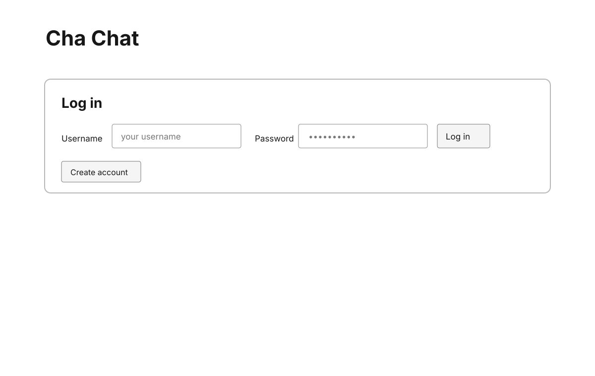
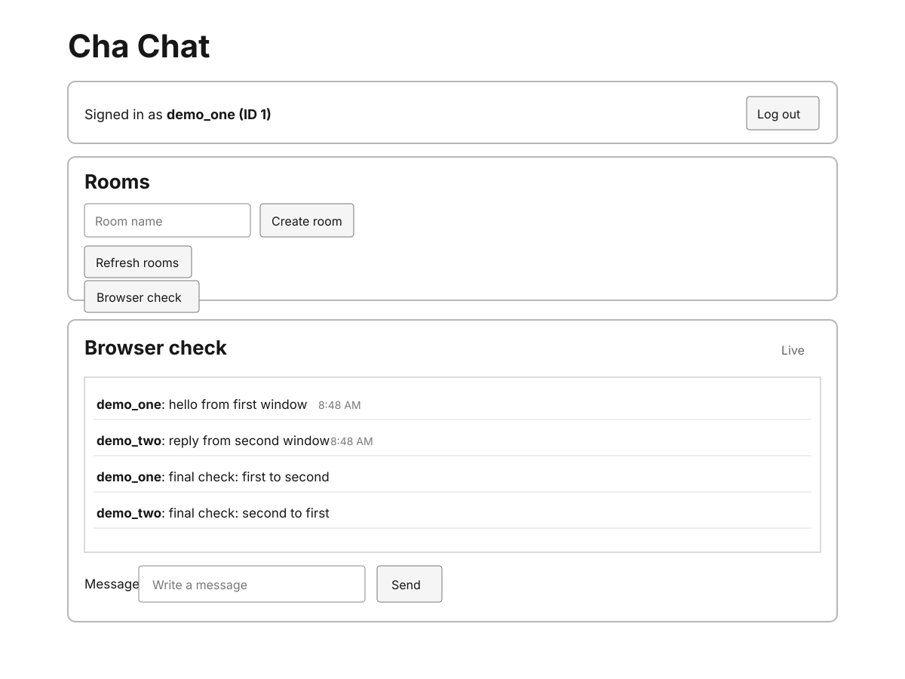

# Cha Chat

Cha Chat is a small group chat app built with Node.js, Express, and SQLite. It includes a single-page browser client served directly by the backend.

## Features

- Create an account and log in with bcrypt-hashed passwords. Authentication uses signed bearer tokens.
- Create rooms and add members by account ID. Room creators manage membership; room-specific endpoints return `403` to non-members.
- Post messages with an atomically assigned, per-room sequence number.
- Load message history in ascending order and page backward with an exclusive `before` sequence cursor.
- Receive live room messages over Server-Sent Events. The stream replays missed messages after reconnect, sends a heartbeat comment every 25 seconds, and removes disconnected clients.
- Use the no-framework demo client to register, log in, create and refresh rooms, open a room, and send live messages.

## Screenshots

The interface screenshots below are SVG files so they remain readable at any display size.





## Requirements

- Node.js 22.5 or newer, which provides the built-in `node:sqlite` module.
- npm.

## Run locally

Install the two runtime dependencies and start the server:

```sh
npm install
npm start
```

Open [http://localhost:3000](http://localhost:3000).

By default, SQLite creates `chat.sqlite3` in the current working directory. Configure the port, database path, and a stable token-signing secret with environment variables:

```sh
PORT=3000 \
DATABASE_PATH=./chat.sqlite3 \
AUTH_TOKEN_SECRET="$(openssl rand -hex 32)" \
npm start
```

Set `AUTH_TOKEN_SECRET` to the same value after each restart so issued tokens remain verifiable. If it is omitted, the app generates a temporary secret when it starts.

## Use the demo

1. Choose **Create account** in each browser session, or log in to existing accounts.
2. In the account that will own the room, create a room. Its account ID appears beside its username.
3. Ask another member for their account ID, enter it in **Add member by account ID**, and add them.
4. In the other session, choose **Refresh rooms**, then open the room.
5. Send messages in either session. Both room views update live.

The client stores the bearer token in browser `localStorage` and uses authenticated `fetch` requests for the SSE stream, allowing it to reconnect with the last received message sequence.

## Run tests

```sh
npm test
```

The Node test suite exercises registration and login, bearer-token protection, room membership access, atomic message sequencing, cursor pagination, SSE broadcast, and reconnect replay. It uses in-memory SQLite databases and starts local HTTP servers on loopback.

## API overview

All API paths are under `/api` and return JSON unless noted.

| Method | Path | Purpose |
| --- | --- | --- |
| `POST` | `/auth/register` | Register and return a bearer token. Body: `{ "username", "password" }`. |
| `POST` | `/auth/login` | Log in and return a bearer token. |
| `GET` | `/auth/me` | Return the authenticated user. |
| `GET` | `/rooms` | List rooms the authenticated user belongs to. |
| `POST` | `/rooms` | Create a room. Body: `{ "name" }`. Creator is added as the first member. |
| `GET` | `/rooms/:id` | Read room details; requires membership. |
| `GET` | `/rooms/:id/members` | List members; requires membership. |
| `POST` | `/rooms/:id/members` | Add a member by ID. Body: `{ "userId": 2 }`. Only the room creator can add members. |
| `GET` | `/rooms/:id/messages?before=10&limit=50` | Read messages before a sequence cursor, in ascending order. `before` is exclusive; `limit` defaults to 50 and is capped at 100. |
| `POST` | `/rooms/:id/messages` | Post a message. Body: `{ "body": "Hello" }`. Requires membership. |
| `GET` | `/rooms/:id/stream` | Authenticated SSE stream. Sends `message` events with sequence IDs; reconnect with `Last-Event-ID` (or `after` on the initial request). Requires membership. |

Send the token on protected requests as `Authorization: Bearer <token>`. Room-specific reads and writes return `403` when the authenticated user is not a member.
